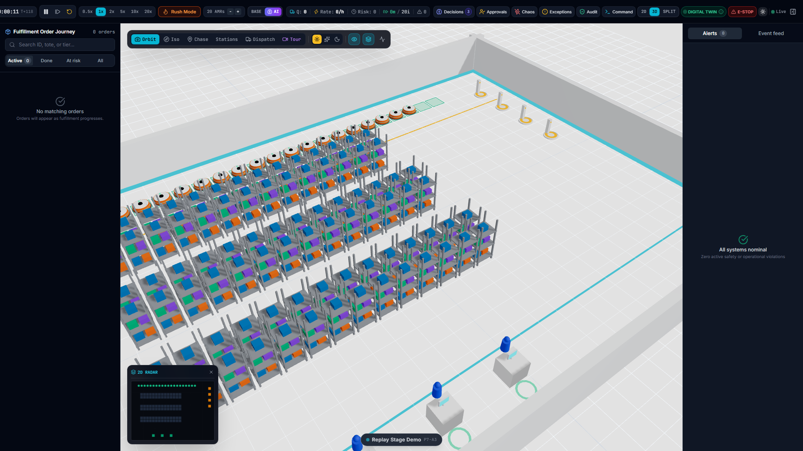
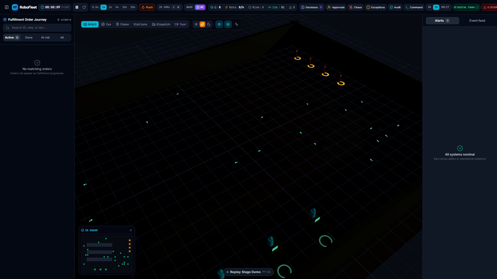
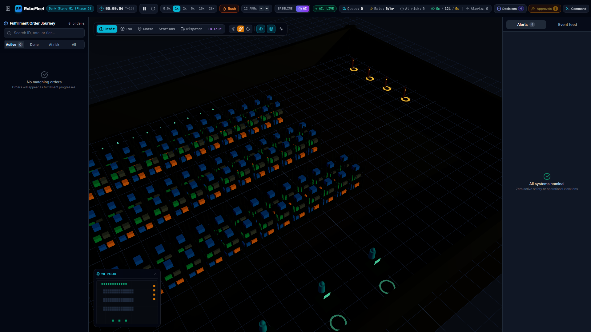
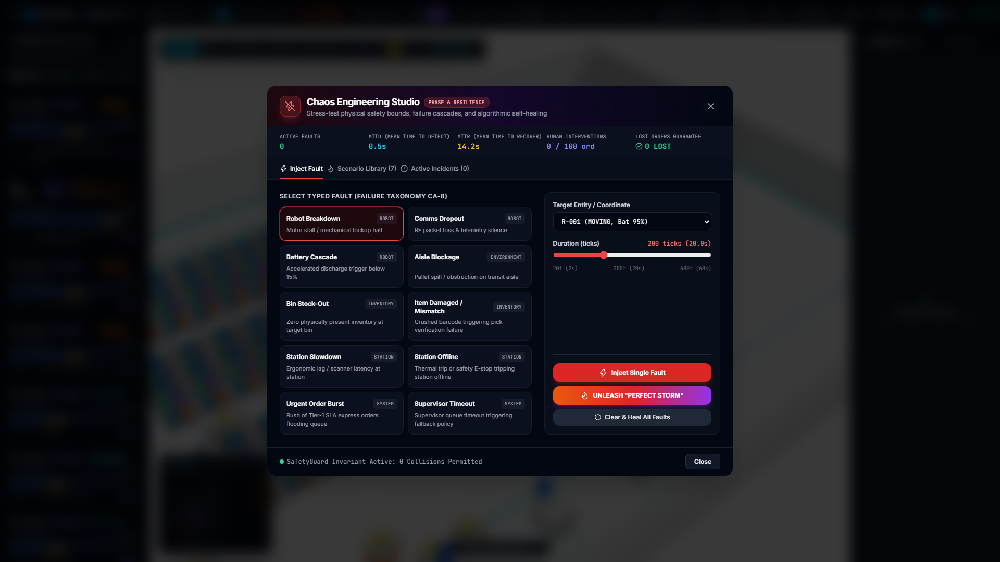
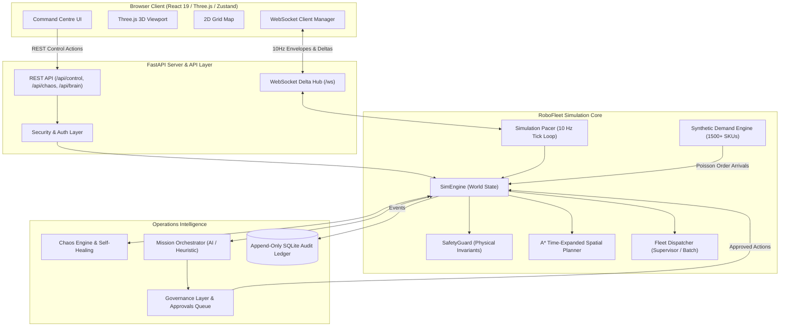
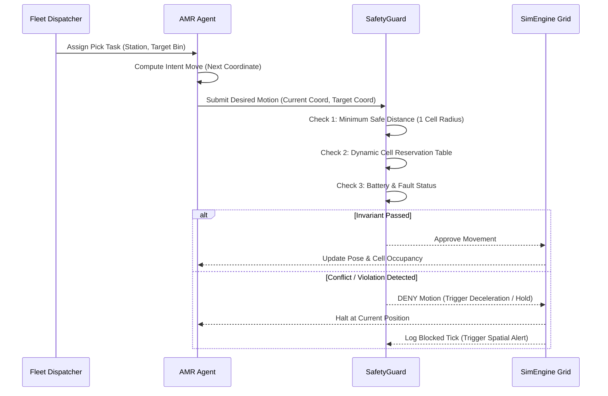

<div align="center">

# 🤖 ROBOFLEET
### Autonomous Mobile Robot (AMR) Fleet Orchestration & Dark Store Digital Twin

[](https://www.python.org/downloads/)
[](https://fastapi.tiangolo.com)
[](https://react.dev)
[](https://www.typescriptlang.org/)
[](https://threejs.org/)
[](https://docs.pytest.org/)
[](https://opensource.org/licenses/MIT)

**A high-performance operations command centre and real-time digital twin for autonomous robot-assisted dark stores.**  
Orchestrates order arrival, multi-agent collision-free path planning, packing station dispatch, physical safety guarantees, and chaos recovery at sub-10ms latency.

[Overview](#-overview) • [Product Showcase](#-product-showcase) • [Architecture](#-system-architecture) • [Core Capabilities](#-core-capabilities) • [Quickstart](#-quickstart) • [API & Streaming](#-api--streaming-protocol) • [Security & Safety](#-security--safety-guarantees)

</div>

---

## 📸 Product Showcase

<div align="center">

### Operational Command Centre (Light & Dark Themes)
*Real-time warehouse visualization with 3D AMR tracking, dynamic pick queue depths, and live order SLA metrics.*


*(High-contrast Light Mode optimized for bright control rooms and operational dashboards)*


*(Dark Theme with spatial alerts, rack density mapping, and real-time telemetry)*

### AI Operations Brain & Live Incident Studio
*Human-in-the-loop operational mitigation proposals, incident injection, and automated self-healing.*

| AI Operations Brain & Approvals | Chaos & Resilience Studio |
| :---: | :---: |
|  |  |
| *Automated anomaly detection, decision audit trail & operator approval queue* | *Scheduled and manual fault injection with MTTR recovery tracking* |

</div>

---

## ⚡ Overview

RoboFleet provides end-to-end orchestration for high-velocity dark stores and automated micro-fulfillment centres. Built to handle 10-minute quick-commerce order commitments, the platform models physical warehouse kinetics, robot battery discharge, and order picking dynamics while offering continuous visibility through a synchronized 2D/3D browser digital twin.

Key design principles:
- **Zero-Accident Safety Boundary**: Deterministic `SafetyGuard` independently verifies every robot motion against physical hardware limits (minimum safe distance, kinetic deceleration, and reserved grid cells) regardless of caller or AI authority.
- **Microsecond Routing & Dispatching**: Spatially coordinated multi-robot path reservation preventing gridlocks in narrow dark store aisles.
- **Bi-Directional Telemetry Streaming**: 10 Hz WebSocket state stream with coalesced backpressure, sequence tracking, and snapshot recovery.
- **Resilience Engineering**: Built-in chaos injection engine evaluating 10 distinct warehouse fault modes with automated self-healing timelines.
- **Human-in-the-Loop Governance**: AI mission orchestrator proposes operational fixes (reslotting, zone holds, emergency reroutes) that require explicit human approval before execution.

---

## 🏛 System Architecture

RoboFleet employs a decoupled, event-driven digital twin architecture connecting a deterministic Python simulation engine to a React Three Fiber command centre:



### SafetyGuard Physical Invariant Loop



---

## 🚀 Core Capabilities

### 1. High-Fidelity 3D/2D Digital Twin
- **Procedural 3D Environment**: High-contrast rendering of racks, storage bins, pick stations, and floor guides powered by `@react-three/fiber` and `@react-three/drei`.
- **Dynamic Camera Modes**: Seamless switching between Orbit (free inspection), Cinematic Tour, Top-Down 2D, Station Focus, and First-Person AMR Follow viewports.
- **Physical AMR Visuals**: Directional LED indicators, payload boxes, battery bars, warning strobes, and ground safety rings on blocked or faulted units.

### 2. Multi-Robot Collision-Free Dispatching
- **Time-Expanded Reservation Grid**: Prevents head-on collisions and gridlock in single-width aisles by booking 4D space-time cells.
- **Flexible Dispatching Strategies**: Supports `robot_supervisor` (idle staging with priority assignment), `batch_greedy` (consolidated pick runs), `edf_deadline` (Earliest Deadline First for SLAs), and `fcfs_nearest`.
- **Intelligent Staging & Sleep**: Idle AMRs park in dedicated staging bays rather than wandering aimlessly, conserving battery and leaving transit corridors clear.

### 3. Chaos Engineering & Self-Healing
- **10 Industrial Fault Modes**: Robot mechanical breakdown, aisle blockage, station queue overload, sensor packet drop, stock-out, battery drain, and compound "Perfect Storm" incidents.
- **Recovery & MTTR Tracking**: Real-time measurement of Mean Time to Recovery (MTTR), degraded mode alerts, and automated traffic rerouting around blocked zones.
- **Self-Healing Policies**: Automatic re-assignment of pending orders from stranded robots to healthy units.

### 4. AI Mission Orchestrator & Governance
- **Autonomous Anomaly Detection**: Proactively identifies order SLA risks, station queue bottlenecks, and low-battery thresholds.
- **Human-in-the-Loop Safeguards**: High-impact mitigation proposals (zone holds, inventory substitutions, bulk reroutes) are routed to an approvals queue for supervisor sign-off.
- **Natural Language Command Parser**: Operators can query system state (`"why is order ORD-102 late?"`) or issue operational instructions with built-in prompt injection defense.

### 5. High-Velocity Order Engine
- **Indian Quick-Commerce Catalogue**: Over 1,500 authentic metro quick-commerce SKUs categorized into dairy, produce, snacks, personal care, and staples with authentic MRP prices (INR).
- **Diurnal Demand Modeling**: Poisson distribution arrival rates simulating breakfast, lunch, tea-time, and evening peak spikes.
- **Rush Mode & Overlays**: Instant simulation of weather storms, cricket match nights, or festival demand surges.

---

## 🛠 Technology Stack

| Layer | Technologies | Purpose |
| :--- | :--- | :--- |
| **Backend Core** | Python 3.12, Pydantic v2, PyYAML, NumPy | Deterministic kinematics, state management, schema enforcement |
| **Web & Streaming** | FastAPI 0.115+, Uvicorn, WebSockets | Async REST endpoints, high-throughput delta stream (10 Hz) |
| **Database** | SQLite3 (WAL Mode) | Append-only audit ledger with immutable database triggers |
| **Frontend Framework**| React 19, TypeScript 5.6, Vite 5.4 | Real-time reactive single-page operations command centre |
| **Graphics & 3D** | Three.js (r187), React Three Fiber, Drei | WebGL 3D digital twin rendering, procedural geometries |
| **Styling & Icons** | Tailwind CSS 3.4, Lucide React | High-contrast dark and light command centre interfaces |
| **Testing & Quality** | Pytest, Hypothesis, Playwright, Ruff, Mypy | 105 automated unit/integration tests, end-to-end browser tests |

---

## 📂 Project Structure

```text
robofleet/
├── backend/
│   ├── src/robofleet/
│   │   ├── adapters/          # Order sources: Synthetic demand, CSV replay, Webhooks
│   │   ├── api/               # FastAPI application, auth middleware, WebSocket manager
│   │   ├── brain/             # AI Orchestrator, Anthropic LLM provider, supervisor NLP
│   │   ├── catalogue/         # SKU generator, co-purchase affinity, popularity slotting
│   │   ├── chaos/             # Fault registry, self-healing manager, degraded modes
│   │   ├── cli/               # CLI commands (serve, run, drills, export-schemas)
│   │   ├── config/            # Pydantic configuration models and YAML loaders
│   │   ├── contracts/         # Typed domain schemas (WorldSnapshot, Layout, Order)
│   │   ├── fleet/             # Station queues, picker simulation, AMR dispatchers
│   │   ├── layout/            # Parametric dark store grid generator
│   │   └── sim/               # Clock pacer, SimEngine, SafetyGuard, A* pathfinder
│   └── tests/                 # Full test suite (105 tests across unit, security, E2E)
├── frontend/
│   ├── src/
│   │   ├── components/        # UI components (AlertBanner, TopBar, OrderBoard, Chaos)
│   │   ├── components/Scene3D # Three.js canvas, Robots3D, Racks3D, Environment3D
│   │   ├── services/          # Typed REST API client and WebSocket hooks
│   │   ├── store/             # Zustand global reactive state store
│   │   └── types/             # Auto-generated TypeScript contract bindings
│   └── index.html             # Single-page application entry point
├── contracts/jsonschema/      # Language-agnostic JSON Schema specifications
├── scenarios/                 # YAML scenario configurations (standard, chaos, rush)
├── tools/                     # Operational utilities (verify_all, run_demo, export_types)
├── Makefile                   # Developer task automation
└── pyproject.toml             # Python package configuration and dependencies
```

---

## ⚡ Quickstart

### Prerequisites
- **Python**: `>= 3.12` (recommended managed via [`uv`](https://docs.astral.sh/uv/))
- **Node.js**: `>= 18.0` & `npm`

### Installation

```bash
# 1. Clone repository
git clone https://github.com/your-org/robofleet.git
cd robofleet

# 2. Set up Python virtual environment & install dependencies
uv venv --python 3.12
uv pip install -e ".[dev]"

# 3. Install frontend dependencies
cd frontend && npm install && cd ..
```

---

## 🖥 Running the Application

### Option 1: Integrated Command Centre (Production Single-Process)
Builds the frontend and launches the integrated FastAPI server serving both the REST/WebSocket API and the compiled 3D UI on a single port:

```bash
uv run python tools/run_demo.py
```
> Open **[http://localhost:8000](http://localhost:8000)** in your browser.

### Option 2: Live Frontend Development Mode (Hot-Reloading)
Run backend simulation and Vite development server in parallel for real-time frontend code changes:

**Terminal 1 (Backend Simulation):**
```bash
uv run robofleet serve --scenario standard --port 8000 --set dispatcher.type=robot_supervisor
```

**Terminal 2 (Frontend Dev Server):**
```bash
cd frontend
npm run dev
```
> Open **[http://localhost:5173](http://localhost:5173)** in your browser.

### Option 3: Headless Simulation CLI
Run headless simulation runs for benchmarking and algorithmic throughput validation:

```bash
uv run python -m robofleet.cli run --scenario standard --duration 3600 --strategy batch_greedy
```

---

## 📡 API & Streaming Protocol

### Key REST Endpoints

| Method | Endpoint | Auth | Description |
| :--- | :--- | :---: | :--- |
| `GET` | `/health` | No | System health probe, tick rate, and active simulation mode |
| `GET` | `/api/environment` | No | Architecture metadata disclosure (seed, layout, adapters) |
| `GET` | `/api/config/effective`| No | Active configuration (with credentials safely redacted) |
| `POST` | `/api/control/pause` | Bearer | Pause simulation clock loop |
| `POST` | `/api/control/resume` | Bearer | Resume simulation clock loop |
| `POST` | `/api/control/speed` | Bearer | Set simulation speed multiplier (0.1x to 20.0x) |
| `POST` | `/api/control/rush` | Bearer | Trigger immediate express order burst with rush multiplier |
| `POST` | `/api/control/emergency_stop` | Bearer | Immediate fleet-wide or zone-specific hardware e-stop |
| `POST` | `/api/chaos/inject` | Bearer | Inject specific fault into target robot or station |
| `POST` | `/api/chaos/load_scenario` | Bearer | Load and schedule a complete YAML chaos scenario |
| `POST` | `/api/brain/supervisor/command` | Bearer | Process natural language query or operational command |

### WebSocket Delta Streaming Protocol (`ws://localhost:8000/ws`)

All clients connect to `/ws` with token authentication (`/ws?token=<token>`). The server executes an initial 3-phase handshake before transitioning to high-frequency state streaming:

1. **`hello` Envelope**: Protocol schema version, supported capabilities, and active feature flags.
2. **`static_world` Envelope**: Complete static spatial metadata (warehouse grid dimensions, rack coordinates, bin slots, SKU catalogue, pick stations).
3. **`snapshot` Envelope**: Full baseline world state (all AMR coordinates, battery levels, active order lines, open alerts).
4. **`delta` Envelopes (10 Hz)**: Incremental state updates (moving AMR positions, completed order items, raised alerts, recent telemetry events).

---

## 🔒 Security & Safety Guarantees

RoboFleet combines physical safety guarantees with modern API perimeter defenses:

- **Perimeter Authentication**: All state-mutating control channels require `ROBOFLEET_TOKEN` bearer authentication. Sensitive credentials are automatically redacted from public configuration disclosures.
- **Path Confinement**: Replay loaders and chaos scenario readers enforce strict directory containment (`Path.is_relative_to`), rejecting path traversal attempts.
- **Physical Safety Invariants**: The `SafetyGuard` module operates independently of application controllers, rejecting commands that violate minimum safe distances or cell boundaries.
- **Tamper-Evident Audit Ledger**: SQLite database triggers reject any `UPDATE` or `DELETE` on the `audit_log` table, guaranteeing an immutable historical operations ledger.
- **Prompt Injection Guardrails**: The NLP supervisor parser sanitizes input against prompt injection patterns and restricts execution to typed domain schemas.

---

## 🧪 Testing & Verification

RoboFleet maintains comprehensive test coverage across all subsystems:

```bash
# Run the complete offline test suite (105 tests)
uv run pytest

# Run linting and secret scanning
uv run ruff check backend/src backend/tests
uv run python tools/scan_secrets.py

# Run static type checking
uv run mypy backend/src
cd frontend && npm run build && cd ..

# Run end-to-end visual verification
uv run python tools/verify_all.py
```

---

## 📄 License

This project is licensed under the MIT License — see the [LICENSE](LICENSE) file for details.
