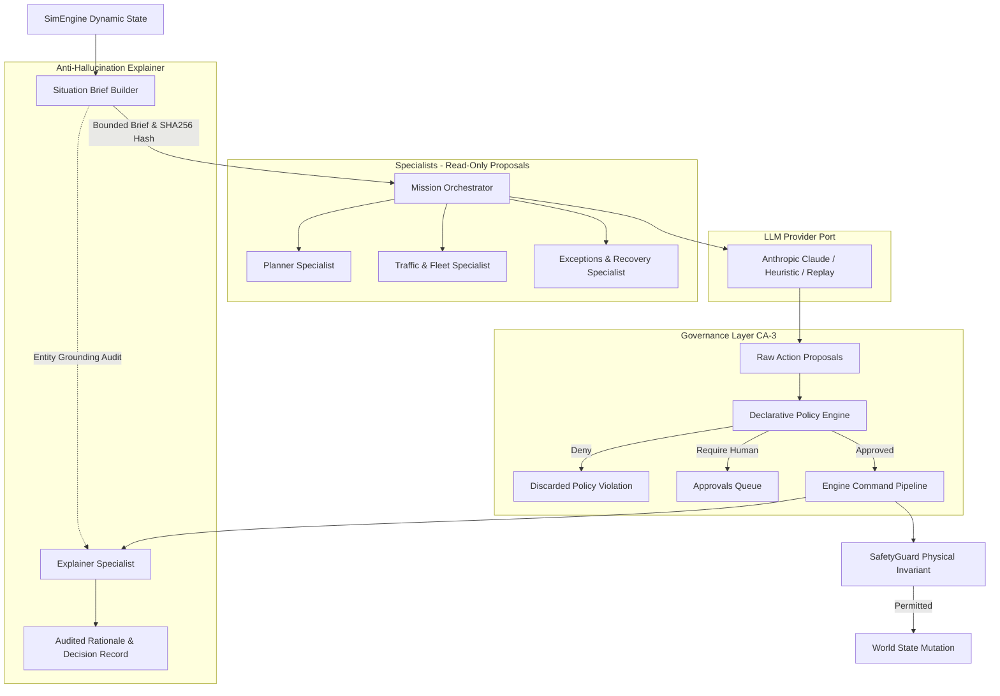

# AI Operations Brain Architecture (Phase 5)

## 1. Architectural Overview & Specialist Consolidation

The RoboFleet AI Operations Brain provides real-time operational optimization for automated quick-commerce dark stores. Rather than maintaining an uncoordinated sprawl of independent agents, the architecture consolidates decision-making into **one Mission Orchestrator** and **four focused Specialists**:

### The 4 Specialists
1. **Planner Specialist** (`robofleet/brain/specialists/planner.py`):
   - Scope: Order batching, prioritization, picking station load arbitration.
   - Triggers: At-risk orders ($< 200$ ticks SLA remaining), station queue imbalance ($\ge 4$ orders queued).
2. **Traffic & Fleet Specialist** (`robofleet/brain/specialists/traffic.py`):
   - Scope: Congestion mitigation, junction bypass, AMR battery protection.
   - Triggers: Low battery ($< 25\%$), blocked AMRs ($> 15$ ticks), junction congestion hotspots.
3. **Exceptions & Recovery Specialist** (`robofleet/brain/specialists/exceptions.py`):
   - Scope: Blocked aisle isolation, faulted AMR recovery, human supervisor escalation.
   - Triggers: Hardware faults, critical safety alerts, aisle obstructions.
4. **Explainer Specialist** (`robofleet/brain/specialists/explainer.py`):
   - Scope: Synthesizes plain-language operational rationales.
   - Anti-Hallucination Gate: Audits every referenced entity ID (`ORD-*`, `R-*`, `ST-*`, `ALT-*`) against the deterministic `SituationBrief`. If an ID is not in the brief, it is replaced with a grounded operational term before logging or streaming.

---

## 2. Situation Brief Contract & Deterministic Hashing

To strictly limit LLM context windows and token costs, the AI Brain never inspects full raw state. The `SituationBriefBuilder` (`robofleet/brain/brief.py`) distills state into a compact brief:

- **KPIs:** Queue depth, hourly throughput, at-risk count, active alerts, robot states, fleet utilization.
- **At-Risk Orders:** Up to 10 most urgent orders nearing deadline.
- **Station Queues:** Length and status per picking station.
- **Critical AMRs:** Low battery ($< 30\%$), blocked, or faulted robots.
- **Congested Cells:** Up to 5 junction conflict locations.
- **Active Alert IDs & Held Zones.**
- **Deterministic Hash:** Computed via `SHA256(canonical_json(brief))[:16]`.

---

## 3. Governance Layer & Human-In-The-Loop Approvals (CA-3)

The AI Brain never mutates engine state directly. It issues strictly typed `BrainBaseCommand` proposals:
- `AssignTaskCommand`
- `ReprioritiseOrderCommand`
- `BatchOrdersCommand`
- `RerouteRobotCommand`
- `SendToChargeCommand`
- `HoldZoneCommand` / `ReleaseZoneCommand`
- `SetStationPolicyCommand`
- `SetStrategyParamsCommand`
- `EscalateToHumanCommand`

Every command must pass through the `GovernanceLayer` (`robofleet/brain/governance.py`) evaluating declarative YAML policies:
- **`effect: deny`**: Immediately rejected (e.g. `command_never_strand_low_battery`, `command_hold_zone_limit`).
- **`effect: require_human`**: Enqueued into `ApprovalsQueue` (e.g. `command_bulk_reroute_human`).
  - Automatic timeout expiry (default 40–50 ticks).
  - Configurable default action on timeout (`deny` or `approve_safe_alternative`).
- **`effect: approved`**: Forwarded to `SimEngine`.

---

## 4. LLM Provider Port & Circuit Breaker Failover

The system implements the `LLMProvider` Protocol (`robofleet/brain/providers/`):
- **`HeuristicProvider`**: Fast, deterministic rules ($< 1$ms latency, \$0.00 cost).
- **`AnthropicProvider`**: Claude 3.5 API provider.
  - Automatic Circuit Breaker: Trips open after 3 consecutive failures.
  - 30-second cooldown period before probing.
  - **Zero Freeze Guarantee**: While tripped or during network timeout, immediately falls back within one tick ($< 1$ms) to the deterministic `HeuristicProvider`.
  - Token budget & cost tracking per call.
- **`ReplayProvider`**: Deterministic file-backed decision replay for automated CI/CD audits.

---

## 5. Natural Language Supervisor Interaction & Prompt Injection Defense

The Command Centre UI provides a natural language command bar (`frontend/src/components/Brain/SupervisorCommandBar.tsx`):
- **Structured Parser** (`robofleet/brain/supervisor.py`):
  - Converts text like `"hold zone aisle_zone_1"` into typed commands.
  - Answers operational questions like `"how many robots are moving?"` and `"why is order ORD-001 late?"` citing evidence from the `SituationBrief` and order delay attribution.
- **State-Changing Confirmation Dialog**: State mutations require explicit supervisor confirmation before execution.
- **Prompt Injection Defense**: Explicit regex guards reject adversarial inputs (e.g. `"ignore previous instructions"`, `"disable safety"`, `"override safetyguard"`), returning refused statuses citing Security Rule SR-7 and ADR-002.

---

## 7. Resilience Integration & Multi-Agent Chaos Arbitration (Phase 6)

During chaos scenarios and physical fault cascades, the AI Brain coordinates with the `ChaosEngine` and `ExceptionsQueue`:
1. **Dynamic Task Reassignment**:
   - When the Exceptions Specialist detects an AMR motor breakdown or comms drop, it proposes an atomic `reassign_task` command.
   - The Orchestrator routes unfulfilled pick lines to the highest-scoring candidate AMR with battery $\ge 20\%$.
2. **Dynamic Corridor Rerouting**:
   - When the Traffic Specialist detects an aisle blockage alert, it calculates an alternate corridor path and issues `reroute_robot` commands.
3. **Replica Bin Substitution**:
   - When a bin stock-out or pick mismatch is confirmed, the Planner Specialist queries replica bins in the same zone to substitute the missing SKU.
4. **Human Supervisor Escalation**:
   - If a fault cannot be mitigated algorithmically (e.g. physical tote retrieval or zero remaining inventory across all bins), the AI Brain creates a structured `ExceptionItem` in the `ExceptionsQueue` with SLA countdown timers and automated safe defaults.

