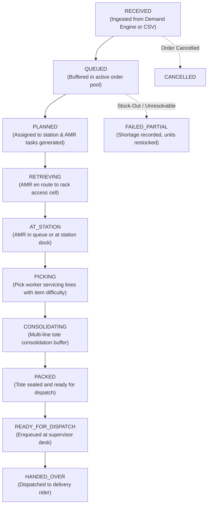

# RoboFleet Fulfilment & Station Operations Engine

This document specifies the order-to-dispatch operations fleet engine (Phase 3). It details the fulfilment lifecycle, picking station mechanics, dispatch bay supervisor handoffs, and strict inventory conservation invariants.

---

## 1. Fulfilment Lifecycle & State Machine

Every dark store customer order progresses through an explicit, auditable sequence of discrete lifecycle stages:

### Lifecycle State Definitions
- **`RECEIVED`**: Ingested via synthetic diurnal demand engine or CSV replay with target SLA deadline and line items.
- **`QUEUED`**: Buffered in the dark store's active order queue awaiting dispatcher assignment.
- **`PLANNED`**: Order selected by dispatcher; picking station assigned (`assigned_station_id`); physical order tote allocated (`tote_id`); first AMR fetch tasks generated.
- **`RETRIEVING`**: Assigned AMR reaches the inventory rack access cell, picks up the storage pod/bin, and navigates towards the station.
- **`AT_STATION`**: AMR has arrived at the station and is either waiting in the approach queue or docked.
- **`PICKING`**: Station worker is actively picking units from the presented bin into the order tote.
- **`CONSOLIDATING`**: All items for multi-line order have arrived at the designated station buffer and undergo consolidation packaging.
- **`PACKED`**: Consolidation complete. Tote is sealed. `ready_tick` is recorded.
- **`READY_FOR_DISPATCH`**: Tote transferred to the dispatch bay waiting for rider arrival.
- **`HANDED_OVER`**: Supervisor hands order to arrival rider. Final `handover_tick` recorded; delay attribution computed.
- **`FAILED_PARTIAL`**: Documented terminal state when physical inventory is insufficient (`SHORT`). Picked units are immediately restocked to preserve unit conservation.
- **`CANCELLED`**: Documented terminal cancellation state.

---

## 2. Physical Station Model & Bounded Queues

Picking stations (`PickingStationManager`) represent the physical human/cobot packing workstations:
1. **Dock Cell**: The primary docking coordinate where AMRs present inventory bins to the pick worker.
2. **Bounded Approach Queue**:
   - Each station has dedicated approach queue cells (`max_queue_capacity`, default = 6).
   - If a station queue is full, AMRs are balanced to alternate stations or hold in place to prevent aisle gridlock.
3. **Item Difficulty Multipliers**:
   - Service time is governed by item characteristics:
     $$\text{Duration (ticks)} = \text{round}\left(T_{\text{base}} \times \text{handling\_difficulty} \times \text{quantity}\right)$$
   - Fragile, heavy, or chilled items (e.g. eggs, glass bottles, ice cream) carry higher handling difficulty ($1.2\times - 1.8\times$), while standard packaged dry goods carry $1.0\times$.
4. **Strict Non-Mixing Invariant (P3-A2)**:
   - All lines of a multi-line order must be consolidated into its unique `tote_id` at its single assigned station.
   - An order cannot transition to `PACKED` until 100% of its required units are present in the consolidation buffer.

---

## 3. Dispatch Bay & Supervisor Rider Handoff

The dispatch staging area (`DispatchBayManager`) models the rapid courier handoff:
1. **Rider Arrival Dynamics**:
   - Couriers arrive following a Poisson process parameterized by `rider_arrival_rate_per_hr` (default 120 riders/hr).
   - Available riders wait in the courier staging area.
2. **Supervisor Desk Queue**:
   - Orders in `READY_FOR_DISPATCH` queue in FCFS order for the supervisor handover desk.
   - Handoff service time includes realistic human verification jitter ($\pm 20\%$ uniform around `base_handoff_ticks`).
   - When handoff completes, `handover_tick` is recorded.

---

## 4. Strict Unit Conservation Invariant (P3-A2)

RoboFleet enforces strict physical unit conservation across every simulation tick:
$$\text{Total Initial Units} = \sum_{b \in \text{Bins}} b.\text{quantity} + \text{Units in Flight} + \text{Units Completed}$$

- **`Bins`**: Physical stock in storage racks.
- **`Units in Flight`**: Items picked from bins currently in station consolidation totes.
- **`Units Completed`**: Items sealed and handed over in dispatched orders.
- If an order terminates abnormally (`FAILED_PARTIAL`), any items already picked are decremented from `units_in_flight` and restocked into rack inventory, strictly preventing phantom units or leaks.
- Verified across all property tests (`test_order_lifecycle_and_unit_conservation`).

---

## 5. Pick Verification Model (SO-101) & Damaged Item Quarantine

In Phase 6, fulfillment integrates the SO-101 sensor pick verification lifecycle:
1. **Verification States**:
   - `COMMANDED`: AMRs present totes to stations; pick verification routine begins.
   - `VERIFIED`: Barcode and scale check passes. Units increment order fulfillment progress.
   - `MISMATCH`: Barcode does not match ordered SKU. Station retries once. If persistent, pick fails and is isolated.
   - `UNVERIFIED`: Barcode unreadable or packaging damaged. Item diverted to quarantine tote.
2. **Damaged Item Isolation & Replacement**:
   - When a pick fails verification, the unit is decremented from shelf inventory and placed into quarantined storage.
   - The fulfillment engine automatically attempts substitution from replica bins in the same temperature zone.
   - If no replica bin has sufficient stock, the line is marked unfulfillable, and the order completes with audited partial fulfillment.
3. **Unit Conservation Under Failure**:
   $$\text{Total Initial Units} \equiv \sum_{b \in \text{Bins}} b.\text{quantity} + \text{Units in Flight} + \text{Units Fulfilled} + \text{Units Quarantined}$$
   Verified over 10,000 picks with realistic error rates in `test_pick_verification_statistical_error_rates_over_10000_picks`.

