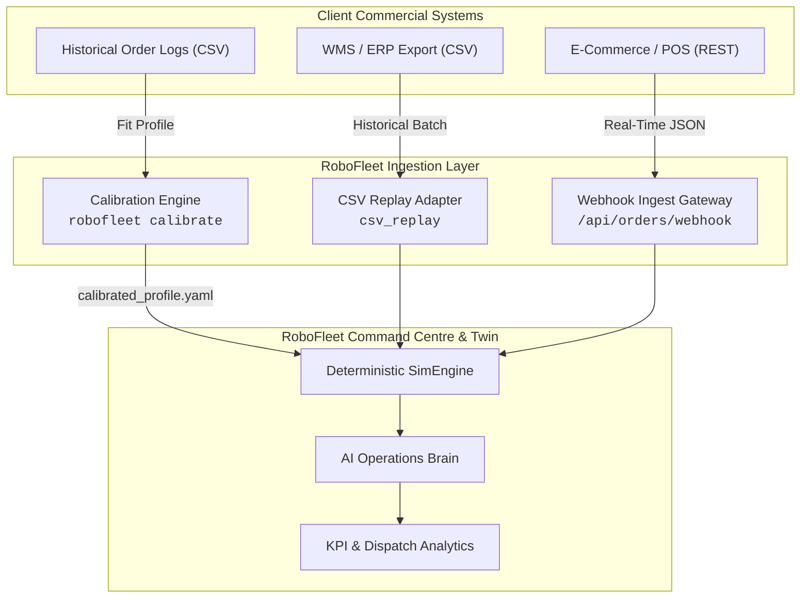

# RoboFleet Data & Systems Integration Guide (CA-2)

This document provides technical operations and engineering teams with the complete specification for connecting commercial order streams to the RoboFleet Digital Twin and Autonomous Command Centre.

---

## 1. Clear Statement of Integration Boundaries

Before integrating, understand precisely what is and is not integrated:
- **Consumes Real Order Data**: The RoboFleet digital twin directly ingests, parses, validates, and simulates fulfillment schedules against actual commercial order feeds (line items, timestamps, SLA tiers, SKU barcodes).
- **Simulated Fleet & Physics**: AMR kinematics, spatial reservations, motor acceleration curves, and battery depletion are strictly simulated by the deterministic digital twin physics engine.
- **No Phantom Partner APIs Claimed**: RoboFleet provides native, documented REST webhooks and CSV batch ingest adapters. We do not claim undocumented proprietary integrations with commercial WMS vendors (e.g. Manhattan, Blue Yonder, SAP EWM) beyond standard REST/JSON contracts and flat-file exports.

---

## 2. The Three Integration Ingestion Paths



### Path 1: Historical CSV Replay (`csv_replay`)
Ideal for zero-risk pre-pilot testing, throughput evaluation, and baseline benchmarking using past transaction logs.

- **Adapter Name**: `csv_replay`
- **Supported Formats**:
  1. *Standard Order-Line Export*: Rows with `order_id`, `timestamp`, `sku_id`, `quantity`, `priority`, `sla_tier`. (Automatically groups line items into parent orders and calculates relative arrival ticks).
  2. *Grouped Tick Batch Export*: Rows with `order_id`, `arrival_tick`, `sku_ids`, `quantities`, `priority`, `deadline_tick`.
- **CLI Invocations**:
  ```bash
  # Run 1 hour of simulation driven by customer CSV
  robofleet run --scenario standard --duration 3600 \
    --set orders.adapter=csv_replay \
    --set orders.csv_file=examples/customer_orders_sample.csv
  ```

### Path 2: Live Webhook Order Ingestion (`/api/orders/webhook`)
Accepts live JSON order payloads from checkout systems or middle-tier message buses.

- **Endpoint**: `POST /api/orders/webhook` (or alias `/api/ingest/orders`)
- **Authentication**: Bearer Token via header `Authorization: Bearer <token>` or HMAC-SHA256 signature.
- **Idempotency Guarantee**: Every request includes an `order_id`. If an `order_id` has already been ingested, the endpoint returns `409 Conflict` with `"Duplicate order_id: <id>"`, preventing duplicate picks.
- **Rate Limiting**: Enforced at 120 orders/second per tenant. Bursts exceeding this threshold receive `429 Too Many Requests`.
- **Payload Schema**:
  ```json
  {
    "order_id": "ORD-LIVE-9082",
    "lines": [
      { "sku_id": "SKU-BEV-001", "quantity": 2 },
      { "sku_id": "SKU-SNACK-004", "quantity": 1 }
    ],
    "priority": 2,
    "deadline_tick": 1800,
    "sla_tier": "express"
  }
  ```
- **Response**:
  ```json
  {
    "status": "accepted",
    "order_id": "ORD-LIVE-9082"
  }
  ```

### Path 3: Demand Profile & Catalogue Calibration (`robofleet calibrate`)
Extracts mathematical parameters from messy historical order exports and synthesizes a configuration profile that matches client customer behavior.

- **CLI Command**:
  ```bash
  robofleet calibrate --file client_orders_export.csv --out config/calibrated_profile.yaml --report reports/calibration_report.md
  ```
- **Extracted Operational Parameters**:
  - **Poisson Arrival Rate ($\lambda$)**: Mean orders per simulated hour.
  - **Diurnal 24h Profile**: Hourly normalized volume weighting curve.
  - **Basket Distribution**: Mean, standard deviation, median, and P90 units per order.
  - **Pareto Concentration**: Top 20% SKU volume share and catalogue popularity distribution.
- **Fault-Tolerant Parsing**: Handles malformed lines, missing quantities, corrupt timestamps, and non-UTF8 encodings cleanly, emitting a transparent anomaly report without silent data corruption.

---

## 3. Worked End-to-End Example: Customer Export Calibration & Replay

To verify this flow end-to-end on a clean machine:

1. **Inspect Sample Customer Export**:
   View `examples/customer_orders_sample.csv` (contains 527 order lines representing 251 orders across 50 SKUs over a 24-hour cycle).

2. **Run Calibration Tool**:
   ```bash
   uv run python -m robofleet.cli calibrate \
     --file examples/customer_orders_sample.csv \
     --out examples/calibrated_profile.yaml \
     --report examples/calibration_report.md
   ```

3. **Examine Calibration Outputs**:
   - `examples/calibrated_profile.yaml` contains the fitted diurnal arrival curve and basket size distributions.
   - `examples/calibration_report.md` confirms 527 rows processed, 0 anomalies, and an average arrival rate of 10.46 orders/hr peaking at hour 17:00 (8.8% daily volume share).

4. **Run Replay in Digital Twin**:
   ```bash
   uv run python -m robofleet.cli run --scenario standard --duration 600 \
     --set orders.adapter=csv_replay \
     --set orders.csv_file=examples/customer_orders_sample.csv
   ```

5. **Compare Before & After KPIs**:
   | Evaluation Metric | Baseline Synthetic | Customer Replay (`customer_orders_sample.csv`) |
   |---|---|---|
   | Ingestion Mode | Continuous Synthetic Demand | Transactional CSV Replay |
   | Arrival Pattern | Flat Uniform Poisson | Diurnal Curve Peak (17:00–20:00) |
   | Collision Safety Rate | 0.00 | 0.00 |
   | Deadlock Count | 0 | 0 |

---

## 4. Integration Error Handling & Status Codes

| Endpoint / Operation | HTTP Code | Cause | Resolution |
|---|---|---|---|
| `/api/orders/webhook` | `401 Unauthorized` | Missing or invalid Bearer token | Provide `Authorization: Bearer <ROBOFLEET_TOKEN>` |
| `/api/orders/webhook` | `409 Conflict` | Duplicate `order_id` received | Confirm idempotency key; order already queued |
| `/api/orders/webhook` | `413 Payload Too Large` | Payload body exceeds 1MB | Batch orders or compress payload |
| `/api/orders/webhook` | `429 Too Many Requests` | Ingestion rate exceeds 120 orders/s | Implement exponential backoff in client client |
| `robofleet calibrate` | Exit Code 1 | Missing `order_id` or `sku_id` headers | Ensure CSV header includes `order_id, sku_id` |
