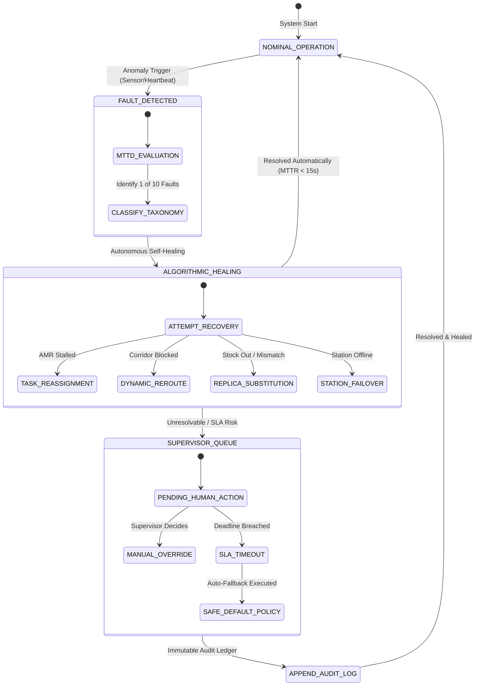

# RoboFleet Resilience & Chaos Engineering Architecture

## 1. Executive Summary

RoboFleet Phase 6 transforms the automated dark store fulfillment platform into an industrial-grade, fault-tolerant, self-healing cyber-physical system. In real-world micro-fulfillment centers, operational faults (motor stalls, RF dropouts, barcode read failures, pallet aisle spills, and sudden order surges) are unavoidable. Phase 6 establishes strict physical invariants, algorithmic first-response recovery, a typed failure taxonomy (CA-8), a 7-scenario chaos stress-testing library, an immutable SQLite audit trail, and human-in-the-loop exception workflows.

---

## 2. Failure Taxonomy (CA-8)

RoboFleet formalizes 10 typed operational failure modes, structured under `backend/src/robofleet/chaos/faults.py`:

| Fault Code | Taxonomy Category | Physical Root Cause | Detection Mechanism (MTTD) | Automated Recovery Pathway | Degraded Mode |
| :--- | :--- | :--- | :--- | :--- | :--- |
| `robot_breakdown` | Robot Hardware | Motor stall, drive wheel lockup, actuator fault | Deadman timer / position stall ($< 1.0\text{s}$) | Task reassignment to nearest idle AMR; dynamic reservation cancel; tow AMR dispatch | `DEGRADED_FLEET_CAPACITY` |
| `robot_comms_drop` | Network / RF | RF blindspot, packet loss, AP roaming timeout | Heartbeat loss $\ge 3$ consecutive ticks ($< 0.3\text{s}$) | Safe velocity ramp-down to 0.0 m/s; hold cell footprint; resume on ping restore | `HOLD_CELL` |
| `battery_cascade` | Energy Storage | Cold zone acceleration, cell imbalance ($< 15\%$) | Battery monitor telemetry delta ($< 0.5\text{s}$) | Immediate route abort; non-preemptible emergency routing to nearest free charger pad | `CHARGER_PRIORITY` |
| `aisle_blocked` | Warehouse Layout | Pallet spill, fallen tote, human worker intrusion | Vision sensor alert / ultrasonic bump ($< 0.2\text{s}$) | Edge removal in A* reservation graph; dynamic recalculation around obstructed corridor | `DETOUR_ACTIVE` |
| `bin_missing_stock` | Inventory | Physical shortage, theft, phantom count disparity | Picker confirmation zero-count report ($< 1.0\text{s}$) | Substitution query to replica bin; line isolation; trigger minimal replenishment order | `LINE_ISOLATION` |
| `item_damaged` | Quality / Vision | Crushed barcode, broken seal, packaging defect | Pick verification sensor mismatch (SO-101) ($< 0.1\text{s}$) | Immediate retry once; divert damaged item to quarantine bin; substitute replica item | `QUARANTINE_BIN` |
| `station_slowdown` | Human / Station | Ergonomic fatigue, scanner latency, scanner sync | Pick duration $\ge 2.5\times$ baseline rolling mean ($< 5.0\text{s}$) | Dynamic load rebalancing; queue throttle to slowed station; reroute new orders | `STATION_THROTTLE` |
| `station_offline` | Physical Station | Emergency stop trip, thermal fuse cutoff | Station heartbeat offline signal ($< 0.1\text{s}$) | Immediate queue drain; active pick handoff to adjacent operational stations | `STATION_FAILOVER` |
| `urgent_order_burst` | Demand Inflow | Flash sale, delivery rider rush ($> 2.5\times$ arrival) | Inflow monitor sliding window ($< 1.0\text{s}$) | Dynamic fleet preemption; express order priority queueing; defer non-urgent restocks | `BURST_FULFILLMENT` |
| `supervisor_unavailable`| Human Governance | Supervisor break, network latency, queue timeout | SLA timeout ticker expiration ($300\text{--}600\text{ ticks}$) | Automatic safe default policy execution (`reassign_task`, `cancel_line`, `delay`) | `AUTO_FALLBACK` |

---

## 3. Robot Fault Lifecycle & State Transitions

---

## 4. Pick Verification Model (SO-101)

Every picking operation at a station follows a four-state verification contract:

1. `COMMANDED`: AMR presents SKU bin to picker; robotic scanner commands verification of barcode and weight.
2. `VERIFIED`: Sensor verifies barcode match and scale reading $\pm 2\%$. Pick increments order fulfilled units.
3. `MISMATCH`: Item barcode does not match target SKU line. Automatic retry once; if mismatch persists, item is flagged and isolated.
4. `UNVERIFIED`: Barcode damaged/unreadable or weight discrepant. Item diverted to quarantine tote; replacement unit pulled from replica bin.

### Unit Conservation Invariant Under Faults
$$\text{Total Units} = \sum \text{Stock in Bins} + \sum \text{Totes in Flight} + \sum \text{Fulfilled Orders} + \sum \text{Isolated Units}$$
Under no circumstances are units created or lost during pick verification errors or inventory stockouts.

---

## 5. Replenishment Lite & Re-Slotting Recommender

- **Replenishment Lite**: Automatically monitors shelf stock levels. When quantity drops below threshold ($Q \le 3$), restock tasks are created for replenishment runners.
- **Urgent Order Priority Policy**: Urgent/express customer fulfillment orders strictly preempt replenishment. Replenishment tasks yield corridors and station docks to active customer orders.
- **Re-Slotting Recommender**: Analyzes SKU order frequency vs distance from picking stations. Outputs travel distance savings recommendations ($> 2.0\text{m/pick}$) without ever moving inventory automatically. Approvals require supervisor authorization validated against Phase 1 physical constraints.
