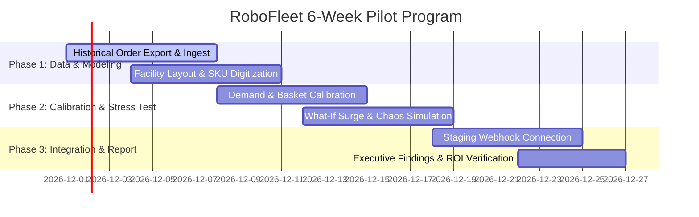

# RoboFleet 6-Week Commercial Pilot Proposal

**Scope**: Digital Twin Calibration, What-If Stress Testing, and Staging Integration for Autonomous Dark Store Operations.

---

## 1. Executive Summary
This proposal outlines a low-risk, non-disruptive 6-week pilot program to evaluate RoboFleet against your micro-fulfillment operations. Using your historical order logs and facility layout, we build a calibrated digital twin to model peak rush behavior, quantify labor savings, and verify zero-collision dispatching prior to physical deployment.

---

## 2. Pilot Timeline & Milestones

### Phase 1: Data Ingestion & Digital Twin Modeling (Weeks 1–2)
- **Client Provides**:
  1. Anonymized 30-day order line export (CSV with timestamps, SKU IDs, quantities).
  2. Dark store layout CAD, blueprint, or aisle dimensions.
  3. Current picking headcount and target delivery SLA windows.
- **RoboFleet Delivers**:
  - Parametric layout generation matching your store dimensions.
  - Automated calibration (`robofleet calibrate`) producing fitted diurnal arrival curves and basket distributions.

### Phase 2: What-If Simulation & Bottleneck Audit (Weeks 3–4)
- **Activities**:
  - Run multi-seed simulations comparing manual baseline vs RoboFleet AMR dispatching under 1x, 2x, and 3x rush demand.
  - Inject chaos fault scenarios (aisle blockages, AMR motor stalls, pick misreads) to measure facility resilience and recovery time.
- **RoboFleet Delivers**:
  - Comprehensive Bottleneck & Throughput Audit report.
  - Recommended fleet sizing (optimal AMR-to-picker ratio).

### Phase 3: Staging Webhook Dry-Run & Decision Gate (Weeks 5–6)
- **Activities**:
  - Connect client staging e-commerce checkout to `/api/orders/webhook`.
  - Shadow order processing: stream real incoming orders through the digital twin alongside physical staff.
- **RoboFleet Delivers**:
  - Side-by-side KPI comparison (Cycle Time, SLA Compliance, Operator Utilization).
  - Executive Business Case & Production Rollout Roadmap.

---

## 3. Success Criteria & KPIs

| Pilot Metric | Target Threshold | Verification Method |
|---|---|---|
| **Collision Rate** | Exactly 0 collisions | Space-time reservation planner invariants |
| **SLA Attainment** | $\ge 99.0\%$ on-time fulfillment under 2.5x rush | Digital twin simulation across 10 paired seeds |
| **Chaos MTTR** | $< 20$ seconds recovery from motor stalls/blocks | Chaos resilience benchmarks |
| **Data Ingestion Accuracy** | $100\%$ valid order parsing | Webhook & CSV replay test harness |

---

*Standard Footnote: All figures measured in the RoboFleet digital twin under stated parametric assumptions. Full evidence reproduced via `make evidence`.*
