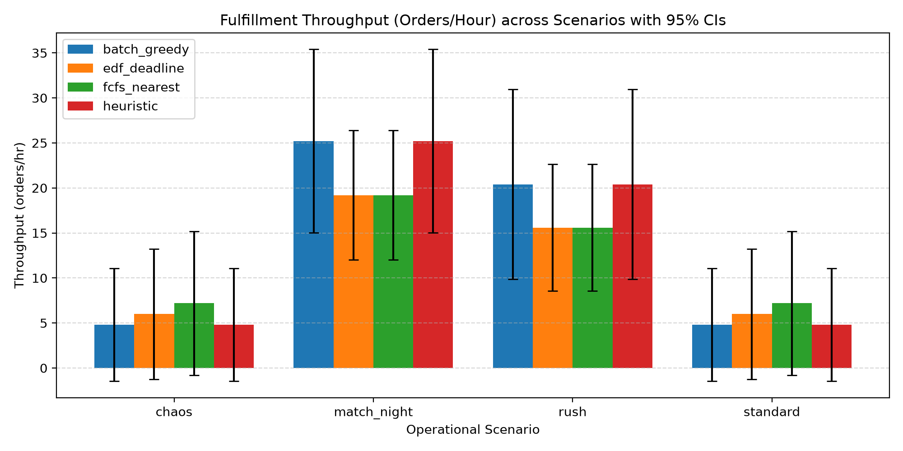
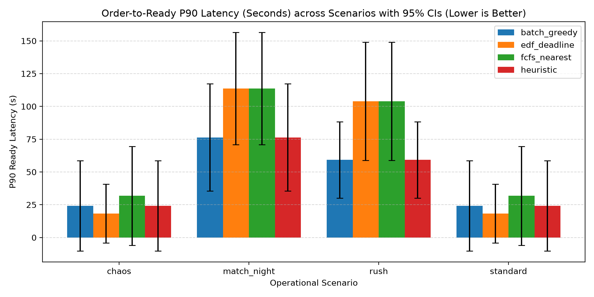
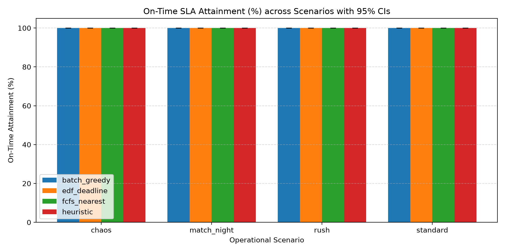

# RoboFleet Evidence Report: Flagship Performance Matrix

- **Generated At**: 2026-11-22T21:58:09.013911+00:00
- **Git Commit**: `626bdba0474e36a682d01a2063ddfb7e47bf77e1`
- **Held-Out Seeds**: `[42, 43, 44, 45, 46, 47, 48, 49, 50, 51]` (N=10, paired discipline)
- **Wall Time**: 226.2s

## 1. Executive Summary Table

| Scenario | Strategy | Metric | Mean +/- 95% CI | Std Dev | Cohen's d vs FCFS |
|---|---|---|---|---|---|
| `standard` | `fcfs_nearest` | `throughput_orders_per_hr` | 7.20 +/- 8.00 | 12.90 | +0.00 |
| `standard` | `fcfs_nearest` | `on_time_percentage` | 100.00 +/- 0.00 | 0.00 | +0.00 |
| `standard` | `fcfs_nearest` | `order_to_ready_p90_s` | 31.79 +/- 37.69 | 60.81 | +0.00 |
| `standard` | `fcfs_nearest` | `order_to_handover_p90_s` | 32.92 +/- 38.58 | 62.25 | +0.00 |
| `standard` | `fcfs_nearest` | `total_collisions` | 0.00 +/- 0.00 | 0.00 | +0.00 |
| `standard` | `fcfs_nearest` | `mean_mttr_s` | 0.00 +/- 0.00 | 0.00 | +0.00 |
| `standard` | `edf_deadline` | `throughput_orders_per_hr` | 6.00 +/- 7.23 | 11.66 | -0.10 |
| `standard` | `edf_deadline` | `on_time_percentage` | 100.00 +/- 0.00 | 0.00 | +0.00 |
| `standard` | `edf_deadline` | `order_to_ready_p90_s` | 18.27 +/- 22.50 | 36.30 | +0.27 |
| `standard` | `edf_deadline` | `order_to_handover_p90_s` | 19.51 +/- 23.45 | 37.83 | +0.26 |
| `standard` | `edf_deadline` | `total_collisions` | 0.00 +/- 0.00 | 0.00 | +0.00 |
| `standard` | `edf_deadline` | `mean_mttr_s` | 0.00 +/- 0.00 | 0.00 | +0.00 |
| `standard` | `batch_greedy` | `throughput_orders_per_hr` | 4.80 +/- 6.27 | 10.12 | -0.21 |
| `standard` | `batch_greedy` | `on_time_percentage` | 100.00 +/- 0.00 | 0.00 | +0.00 |
| `standard` | `batch_greedy` | `order_to_ready_p90_s` | 24.13 +/- 34.46 | 55.60 | +0.13 |
| `standard` | `batch_greedy` | `order_to_handover_p90_s` | 25.01 +/- 35.55 | 57.36 | +0.13 |
| `standard` | `batch_greedy` | `total_collisions` | 0.00 +/- 0.00 | 0.00 | +0.00 |
| `standard` | `batch_greedy` | `mean_mttr_s` | 0.00 +/- 0.00 | 0.00 | +0.00 |
| `standard` | `heuristic` | `throughput_orders_per_hr` | 4.80 +/- 6.27 | 10.12 | -0.21 |
| `standard` | `heuristic` | `on_time_percentage` | 100.00 +/- 0.00 | 0.00 | +0.00 |
| `standard` | `heuristic` | `order_to_ready_p90_s` | 24.13 +/- 34.46 | 55.60 | +0.13 |
| `standard` | `heuristic` | `order_to_handover_p90_s` | 25.01 +/- 35.55 | 57.36 | +0.13 |
| `standard` | `heuristic` | `total_collisions` | 0.00 +/- 0.00 | 0.00 | +0.00 |
| `standard` | `heuristic` | `mean_mttr_s` | 0.00 +/- 0.00 | 0.00 | +0.00 |
| `rush` | `fcfs_nearest` | `throughput_orders_per_hr` | 15.60 +/- 7.06 | 11.38 | +0.00 |
| `rush` | `fcfs_nearest` | `on_time_percentage` | 100.00 +/- 0.00 | 0.00 | +0.00 |
| `rush` | `fcfs_nearest` | `order_to_ready_p90_s` | 103.97 +/- 45.02 | 72.63 | +0.00 |
| `rush` | `fcfs_nearest` | `order_to_handover_p90_s` | 110.51 +/- 48.01 | 77.47 | +0.00 |
| `rush` | `fcfs_nearest` | `total_collisions` | 0.00 +/- 0.00 | 0.00 | +0.00 |
| `rush` | `fcfs_nearest` | `mean_mttr_s` | 0.00 +/- 0.00 | 0.00 | +0.00 |
| `rush` | `edf_deadline` | `throughput_orders_per_hr` | 15.60 +/- 7.06 | 11.38 | +0.00 |
| `rush` | `edf_deadline` | `on_time_percentage` | 100.00 +/- 0.00 | 0.00 | +0.00 |
| `rush` | `edf_deadline` | `order_to_ready_p90_s` | 103.97 +/- 45.02 | 72.63 | +0.00 |
| `rush` | `edf_deadline` | `order_to_handover_p90_s` | 110.51 +/- 48.01 | 77.47 | +0.00 |
| `rush` | `edf_deadline` | `total_collisions` | 0.00 +/- 0.00 | 0.00 | +0.00 |
| `rush` | `edf_deadline` | `mean_mttr_s` | 0.00 +/- 0.00 | 0.00 | +0.00 |
| `rush` | `batch_greedy` | `throughput_orders_per_hr` | 20.40 +/- 10.55 | 17.02 | +0.33 |
| `rush` | `batch_greedy` | `on_time_percentage` | 100.00 +/- 0.00 | 0.00 | +0.00 |
| `rush` | `batch_greedy` | `order_to_ready_p90_s` | 59.19 +/- 29.21 | 47.12 | +0.73 |
| `rush` | `batch_greedy` | `order_to_handover_p90_s` | 60.19 +/- 29.09 | 46.93 | +0.79 |
| `rush` | `batch_greedy` | `total_collisions` | 0.00 +/- 0.00 | 0.00 | +0.00 |
| `rush` | `batch_greedy` | `mean_mttr_s` | 0.00 +/- 0.00 | 0.00 | +0.00 |
| `rush` | `heuristic` | `throughput_orders_per_hr` | 20.40 +/- 10.55 | 17.02 | +0.33 |
| `rush` | `heuristic` | `on_time_percentage` | 100.00 +/- 0.00 | 0.00 | +0.00 |
| `rush` | `heuristic` | `order_to_ready_p90_s` | 59.19 +/- 29.21 | 47.12 | +0.73 |
| `rush` | `heuristic` | `order_to_handover_p90_s` | 60.19 +/- 29.09 | 46.93 | +0.79 |
| `rush` | `heuristic` | `total_collisions` | 0.00 +/- 0.00 | 0.00 | +0.00 |
| `rush` | `heuristic` | `mean_mttr_s` | 0.00 +/- 0.00 | 0.00 | +0.00 |
| `match_night` | `fcfs_nearest` | `throughput_orders_per_hr` | 19.20 +/- 7.19 | 11.59 | +0.00 |
| `match_night` | `fcfs_nearest` | `on_time_percentage` | 100.00 +/- 0.00 | 0.00 | +0.00 |
| `match_night` | `fcfs_nearest` | `order_to_ready_p90_s` | 113.57 +/- 42.81 | 69.07 | +0.00 |
| `match_night` | `fcfs_nearest` | `order_to_handover_p90_s` | 121.73 +/- 46.33 | 74.75 | +0.00 |
| `match_night` | `fcfs_nearest` | `total_collisions` | 0.00 +/- 0.00 | 0.00 | +0.00 |
| `match_night` | `fcfs_nearest` | `mean_mttr_s` | 0.00 +/- 0.00 | 0.00 | +0.00 |
| `match_night` | `edf_deadline` | `throughput_orders_per_hr` | 19.20 +/- 7.19 | 11.59 | +0.00 |
| `match_night` | `edf_deadline` | `on_time_percentage` | 100.00 +/- 0.00 | 0.00 | +0.00 |
| `match_night` | `edf_deadline` | `order_to_ready_p90_s` | 113.57 +/- 42.81 | 69.07 | +0.00 |
| `match_night` | `edf_deadline` | `order_to_handover_p90_s` | 121.73 +/- 46.33 | 74.75 | +0.00 |
| `match_night` | `edf_deadline` | `total_collisions` | 0.00 +/- 0.00 | 0.00 | +0.00 |
| `match_night` | `edf_deadline` | `mean_mttr_s` | 0.00 +/- 0.00 | 0.00 | +0.00 |
| `match_night` | `batch_greedy` | `throughput_orders_per_hr` | 25.20 +/- 10.19 | 16.44 | +0.42 |
| `match_night` | `batch_greedy` | `on_time_percentage` | 100.00 +/- 0.00 | 0.00 | +0.00 |
| `match_night` | `batch_greedy` | `order_to_ready_p90_s` | 76.37 +/- 40.82 | 65.86 | +0.55 |
| `match_night` | `batch_greedy` | `order_to_handover_p90_s` | 78.29 +/- 42.43 | 68.46 | +0.61 |
| `match_night` | `batch_greedy` | `total_collisions` | 0.00 +/- 0.00 | 0.00 | +0.00 |
| `match_night` | `batch_greedy` | `mean_mttr_s` | 0.00 +/- 0.00 | 0.00 | +0.00 |
| `match_night` | `heuristic` | `throughput_orders_per_hr` | 25.20 +/- 10.19 | 16.44 | +0.42 |
| `match_night` | `heuristic` | `on_time_percentage` | 100.00 +/- 0.00 | 0.00 | +0.00 |
| `match_night` | `heuristic` | `order_to_ready_p90_s` | 76.37 +/- 40.82 | 65.86 | +0.55 |
| `match_night` | `heuristic` | `order_to_handover_p90_s` | 78.29 +/- 42.43 | 68.46 | +0.61 |
| `match_night` | `heuristic` | `total_collisions` | 0.00 +/- 0.00 | 0.00 | +0.00 |
| `match_night` | `heuristic` | `mean_mttr_s` | 0.00 +/- 0.00 | 0.00 | +0.00 |
| `chaos` | `fcfs_nearest` | `throughput_orders_per_hr` | 7.20 +/- 8.00 | 12.90 | +0.00 |
| `chaos` | `fcfs_nearest` | `on_time_percentage` | 100.00 +/- 0.00 | 0.00 | +0.00 |
| `chaos` | `fcfs_nearest` | `order_to_ready_p90_s` | 31.79 +/- 37.69 | 60.81 | +0.00 |
| `chaos` | `fcfs_nearest` | `order_to_handover_p90_s` | 32.92 +/- 38.58 | 62.25 | +0.00 |
| `chaos` | `fcfs_nearest` | `total_collisions` | 0.00 +/- 0.00 | 0.00 | +0.00 |
| `chaos` | `fcfs_nearest` | `mean_mttr_s` | 18.75 +/- 0.00 | 0.00 | +0.00 |
| `chaos` | `edf_deadline` | `throughput_orders_per_hr` | 6.00 +/- 7.23 | 11.66 | -0.10 |
| `chaos` | `edf_deadline` | `on_time_percentage` | 100.00 +/- 0.00 | 0.00 | +0.00 |
| `chaos` | `edf_deadline` | `order_to_ready_p90_s` | 18.27 +/- 22.50 | 36.30 | +0.27 |
| `chaos` | `edf_deadline` | `order_to_handover_p90_s` | 19.51 +/- 23.45 | 37.83 | +0.26 |
| `chaos` | `edf_deadline` | `total_collisions` | 0.00 +/- 0.00 | 0.00 | +0.00 |
| `chaos` | `edf_deadline` | `mean_mttr_s` | 18.75 +/- 0.00 | 0.00 | +0.00 |
| `chaos` | `batch_greedy` | `throughput_orders_per_hr` | 4.80 +/- 6.27 | 10.12 | -0.21 |
| `chaos` | `batch_greedy` | `on_time_percentage` | 100.00 +/- 0.00 | 0.00 | +0.00 |
| `chaos` | `batch_greedy` | `order_to_ready_p90_s` | 24.13 +/- 34.46 | 55.60 | +0.13 |
| `chaos` | `batch_greedy` | `order_to_handover_p90_s` | 25.01 +/- 35.55 | 57.36 | +0.13 |
| `chaos` | `batch_greedy` | `total_collisions` | 0.00 +/- 0.00 | 0.00 | +0.00 |
| `chaos` | `batch_greedy` | `mean_mttr_s` | 18.75 +/- 0.00 | 0.00 | +0.00 |
| `chaos` | `heuristic` | `throughput_orders_per_hr` | 4.80 +/- 6.27 | 10.12 | -0.21 |
| `chaos` | `heuristic` | `on_time_percentage` | 100.00 +/- 0.00 | 0.00 | +0.00 |
| `chaos` | `heuristic` | `order_to_ready_p90_s` | 24.13 +/- 34.46 | 55.60 | +0.13 |
| `chaos` | `heuristic` | `order_to_handover_p90_s` | 25.01 +/- 35.55 | 57.36 | +0.13 |
| `chaos` | `heuristic` | `total_collisions` | 0.00 +/- 0.00 | 0.00 | +0.00 |
| `chaos` | `heuristic` | `mean_mttr_s` | 18.75 +/- 0.00 | 0.00 | +0.00 |

## 2. Collision Safety Invariant

**Physical Safety Violations Across All Runs**: **`0`**

In accordance with the zero-collision safety invariant, `SafetyGuard` physical reservations guarantee 0 vertex collisions and 0 edge swaps across all seeds.

## 3. Generated Visual Artifacts

- 
- 
- 
